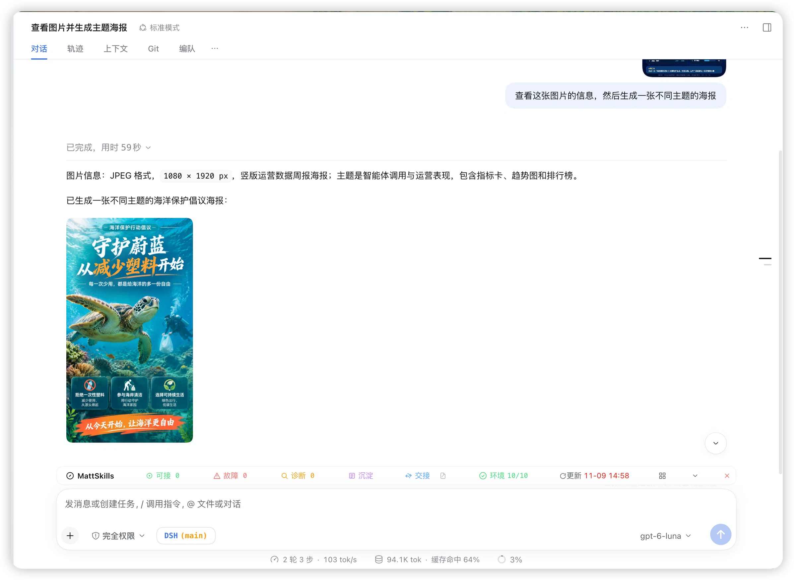

# DSH Media Studio

在 DeepSeek Harness (DSH) 对话里生成图片、预览结果，并把图片保存到当前工作区。

An open-source DSH bundle that generates images through an existing OpenAI Images-compatible provider, saves them in the active workspace, and displays an inline image gallery. Bring your own provider and API key.

## 使用效果

在对话中描述你想要的图片即可，例如：

> 生成一张海洋保护主题的竖版中文海报，海龟游过珊瑚礁，标题为“守护蔚蓝，从减少塑料开始”。



截图展示的是作者本机环境；底部 MattSkills、Git、上下文等界面来自其他插件，不属于本插件。

## 能做什么

- 注册 `generate_image` 工具，单次生成 1–4 张图片，模型来自 DSH 已配置的 provider。
- 支持 OpenAI Images 风格的 `/v1/images/generations` 接口，读取 `data[].b64_json` 或下载 `data[].url`。
- 将结果保存为当前会话工作区中的文件，验证路径后返回可直接使用的 Markdown 图片引用。
- 在 Web 对话的工具卡片里展示画廊；点击图片可查看原图，预览副本通过 DSH 鉴权路由提供。
- API 地址、模型目录和凭据引用统一读取 DSH 配置，不在插件中内置供应商或密钥。

## 环境要求

- DSH `0.2.2-rc.3` 或兼容的后续 `0.2.x`；当前按 `0.2.2-rc.3` 接口整理，后续版本兼容性需实际验证。
- DSH Web / Desktop，提供 `webServer`、`connection`、`settings`、`credentials`、`sessions`、`workingDirectory` 和工具服务。
- 一个接受以下请求格式的图片生成服务，以及对应 API key。

```json
{
  "model": "your-image-model-id",
  "prompt": "A poster about protecting the ocean",
  "n": 1,
  "response_format": "b64_json"
}
```

这是纯 JavaScript bundle，无构建步骤和第三方运行时依赖。

## 安装

```bash
git clone https://github.com/Siriuskangkang/dsh-media-studio.git
```

在 DSH 的 **插件 / Plugins → 添加插件 / Add plugin** 中选择克隆后的本地目录。也可让 DSH 助手执行：

> 使用 plugin_manager 安装本地目录 `/absolute/path/dsh-media-studio`。

此仓库通过 GitHub 开源，尚未发布到 npm；不要将仓库名当作已存在的 npm 包安装。安装后本 bundle 会同时注册图片预览路由和生图工具，无需额外的 Studio 模式。替换正在运行的旧版插件时，按 DSH 安装回执提示重启。

## 配置图片服务

1. 在 DSH 设置中，为 `@deepseek-ai/dsh-llm-pi-ai` 添加一个 provider，默认路由 ID 为 `image`。
2. 配置 `api: openai-completions`、图片接口的 `baseURL`、`apiKeyEnv` 凭据引用和非空 `models` 列表；在 DSH 凭据设置中保存 key。
3. 在对话里请求生图；需要指定模型时使用 provider 中声明的模型 ID，省略时选择第一项。

下面仅是 provider 配置字段示例，将它合并到现有 provider 设置，不要覆盖其他路由：

```yaml
providers:
  image:
    displayName: My image service
    api: openai-completions
    baseURL: https://your-image-service.example/v1
    apiKeyEnv: IMAGE_API_KEY
    models:
      - id: your-image-model-id
        name: My image model
```

如果已有路由，例如 `my-images`，在 DSH 配置编辑器中设置 `media-studio-tools` 插件行：

```yaml
imageProvider: my-images
```

这只是该行的 `config` 内容。首次未配置服务也能安装插件，执行生图时会明确提示缺少的 provider、模型或凭据。服务配置每次执行时重新读取。

## 数据与限制

提示词会发送给你配置的服务，可能产生费用。生成图片存入当前工作区，同时在 DSH 数据目录 `media-studio/files` 保存预览副本；停用插件会移除生成工具和预览路由，不会删除已有文件。

目前仅支持文字生成图片：不上传参考图、不做图片编辑，也没有视频生成工具。截图中的“查看原图再生成”由聊天模型先理解图片，再把文字提示传给生图工具；原图不会作为请求附件发送给图片服务。

请求不包含 `size`、`quality` 或自定义 headers，不支持 OAuth-only 凭据。服务需支持 `response_format: b64_json`，虽然也能读取 URL 返回值。baseURL 以 `/v1` 结尾时直接添加 `/images/generations`，否则添加 `/v1/images/generations`。

若原 profile 已注册同名 `generate_image`、`media-studio` 或 `media-studio-tools`，先停用或移除旧版对应项，避免重复注册。截图来自原本机版本；此开源版本增加了独立安装所需的工具行。

## 开发与验证

```bash
npm test
npm pack --dry-run
```

测试用模拟 HTTP 返回验证图片保存、工作区路径与模型可见输出，不调用付费服务。现有截图展示实际使用效果；开源打包版本的全新 profile 安装和付费 API 调用未作独立端到端复测。

主要入口：`index.js` 提供媒体路由，`tools.js` 注册生成工具，`image-paths.js` 校验工作区图片引用，`client.js` 渲染画廊。

## License

[MIT](LICENSE) © 2026 Siriuskangkang。示例截图由作者提供，用于展示使用方式。本项目为社区插件，与 DeepSeek 官方无隶属关系。
